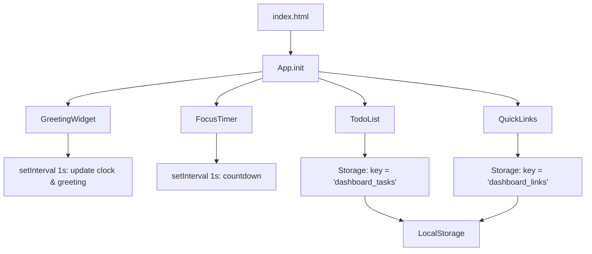

# Design Document: To-Do List Life Dashboard

## Overview

To-Do List Life Dashboard adalah halaman web satu-halaman (single-page) yang dibangun sepenuhnya dengan HTML, CSS, dan Vanilla JavaScript tanpa framework atau backend. Dashboard menampilkan empat widget utama: Greeting/Clock Widget, Focus Timer (Pomodoro), To-Do List, dan Quick Links. Semua data persisten disimpan di sisi klien menggunakan browser Local Storage API.

**Tujuan desain:**
- Sederhana dan dapat digunakan langsung dari file lokal (`file://`) maupun server statis.
- Tidak ada dependensi eksternal — tidak ada CDN, tidak ada build tool, tidak ada server.
- Responsif dari 320px (mobile) hingga 1920px (desktop wide).
- Modular secara logika: setiap widget berdiri sendiri dalam kode JS, namun tetap dalam satu file.

---

## Architecture

### Struktur File

```
index.html          ← satu-satunya file HTML
css/
  style.css         ← semua styling
js/
  app.js            ← semua logika JavaScript
```

### Pola Arsitektur

Karena proyek ini hanya menggunakan Vanilla JS tanpa framework, pola yang digunakan adalah **Module Pattern** berbasis objek literal: setiap widget dikapsulasi sebagai objek dengan metode `init()`, state internal, dan DOM binding-nya sendiri. Semua modul diinisialisasi oleh satu fungsi `App.init()` pada saat `DOMContentLoaded`.

```
App.init()
  ├── GreetingWidget.init()
  ├── FocusTimer.init()
  ├── TodoList.init()
  └── QuickLinks.init()
```

**Aliran Data:**

```
User Interaction
      │
      ▼
DOM Event Handler (di widget masing-masing)
      │
      ▼
State Update (objek in-memory)
      │
      ├──► Render DOM (tampilkan perubahan)
      └──► Storage.save() → LocalStorage
```

Saat halaman dimuat:
```
DOMContentLoaded
      │
      ▼
Storage.load() ← LocalStorage
      │
      ▼
Render DOM awal setiap widget
```

### Diagram Komponen



---

## Components and Interfaces

### 1. GreetingWidget

**Tanggung jawab:** Menampilkan jam berjalan (real-time), tanggal lengkap dalam Bahasa Indonesia, dan salam berdasarkan jam saat ini.

**Interface:**
```javascript
const GreetingWidget = {
  init()         // Pasang ke DOM, mulai interval 1 detik
  update()       // Baca Date(), perbarui jam, tanggal, salam
  formatTime(date)     // → string "HH:MM:SS"
  formatDate(date)     // → string "Kamis, 16 Oktober 2026"
  getGreeting(hour)    // → string salam berdasarkan jam
};
```

**Logika salam:**

| Rentang Jam      | Teks Salam       |
|------------------|------------------|
| 05:00–11:59      | Selamat Pagi     |
| 12:00–17:59      | Selamat Siang    |
| 18:00–20:59      | Selamat Sore     |
| 21:00–04:59      | Selamat Malam    |
| Tidak tersedia   | Halo             |

**Error handling:** Jika `new Date()` gagal atau `isNaN`, tampilkan `"--:--:--"` untuk waktu dan `"Halo"` untuk salam.

---

### 2. FocusTimer

**Tanggung jawab:** Hitung-mundur 25 menit (Pomodoro). Mengelola state: idle / running. Tombol Start, Stop, Reset.

**Interface:**
```javascript
const FocusTimer = {
  DURATION_SECONDS: 1500,   // 25 * 60
  state: { remaining: 1500, isRunning: false, intervalId: null },

  init()       // Render tampilan awal, pasang event listener tombol
  start()      // Mulai interval countdown
  stop()       // Bersihkan interval, isRunning = false
  reset()      // Stop + kembalikan remaining ke DURATION_SECONDS
  tick()       // Kurangi remaining 1, cek if 0 → onComplete()
  onComplete() // Hentikan timer, tampilkan indikator selesai, mainkan suara
  render()     // Perbarui DOM: tampilan waktu + state tombol
  formatTime(seconds) // → string "MM:SS"
};
```

**State machine:**
```
         [Start]           [Stop]
IDLE ─────────────► RUNNING ──────────► IDLE
  ▲                    │                  ▲
  │   [Reset]          │ [reaches 00:00]  │
  └────────────────────┴──────────────────┘
                   COMPLETED ──► IDLE (setelah notifikasi)
```

**Keputusan desain:** Tombol Reset aktif di semua state untuk kemudahan penggunaan (baik idle maupun running).

---

### 3. TodoList

**Tanggung jawab:** CRUD tugas (tambah, edit, tandai selesai/batal, hapus). Persistensi ke Local Storage.

**Interface:**
```javascript
const TodoList = {
  tasks: [],          // Array Task in-memory
  editingId: null,    // ID task yang sedang diedit

  init()              // Muat dari storage, render awal, pasang event listener
  addTask(text)       // Validasi, buat Task baru, simpan, render
  editTask(id)        // Aktifkan mode edit pada task dengan id
  saveEdit(id, text)  // Validasi, perbarui task, keluar mode edit, simpan
  cancelEdit(id)      // Batalkan edit, kembalikan ke tampilan normal
  toggleTask(id)      // Toggle status done, simpan, render
  deleteTask(id)      // Hapus task dari array, simpan, render
  render()            // Bangun ulang DOM daftar tugas
  save()              // Serialisasi tasks → JSON → LocalStorage
  load()              // Baca LocalStorage → parse JSON → this.tasks
};
```

**Validasi input:**
- Teks tugas: 1–500 karakter setelah `trim()`.
- Input kosong / hanya spasi → tampilkan error, jangan tambah task.

**Event delegation:** Gunakan satu event listener pada container `<ul>` untuk menangkap klik tombol edit/selesai/hapus pada setiap `<li>` anak, menggunakan `data-id` dan `data-action` attribute.

---

### 4. QuickLinks

**Tanggung jawab:** Tambah dan hapus tautan favorit. Buka link di tab baru. Persistensi ke Local Storage.

**Interface:**
```javascript
const QuickLinks = {
  links: [],      // Array Link in-memory

  init()          // Muat dari storage, render awal, pasang event listener
  addLink(name, url)    // Validasi, normalisasi URL, buat Link, simpan, render
  deleteLink(id)        // Hapus link dari array, simpan, render
  normalizeUrl(url)     // Tambah "https://" jika tidak diawali "http(s)://"
  validateUrl(url)      // Cek apakah URL valid setelah normalisasi
  render()              // Bangun ulang DOM daftar kartu/tombol link
  save()                // Serialisasi links → JSON → LocalStorage
  load()                // Baca LocalStorage → parse JSON → this.links
};
```

**Validasi:**
- Nama tampilan: 1–50 karakter setelah `trim()`.
- URL: tidak kosong, dan setelah normalisasi harus diawali `http://` atau `https://`.
- Setiap Link dibuka dengan `target="_blank"` dan `rel="noopener noreferrer"` untuk keamanan.

---

### 5. Storage (modul utilitas)

**Tanggung jawab:** Abstraksi tipis di atas `localStorage` dengan penanganan error terpusat.

```javascript
const Storage = {
  KEYS: {
    TASKS: 'dashboard_tasks',
    LINKS: 'dashboard_links',
  },
  save(key, data)   // JSON.stringify + localStorage.setItem, tangkap SecurityError
  load(key)         // localStorage.getItem + JSON.parse, kembalikan null jika gagal
  isAvailable()     // Cek ketersediaan localStorage (try/catch test write)
};
```

**Alasan pemisahan modul Storage:** Memusatkan penanganan `SecurityError` (mode private browser) dan `QuotaExceededError` sehingga widget tidak perlu duplikasi try/catch.

---

## Data Models

### Task

```javascript
/**
 * @typedef {Object} Task
 * @property {string} id        - UUID unik (crypto.randomUUID() atau fallback Date.now())
 * @property {string} text      - Deskripsi tugas (1–500 karakter)
 * @property {boolean} done     - Status selesai: false = belum, true = selesai
 * @property {number} createdAt - Timestamp Unix (ms) saat task dibuat
 */

// Contoh:
{
  id: "a1b2c3d4-e5f6-...",
  text: "Belajar desain sistem",
  done: false,
  createdAt: 1729123456789
}
```

**Penyimpanan:** Disimpan sebagai JSON array di `localStorage['dashboard_tasks']`.

---

### Link

```javascript
/**
 * @typedef {Object} Link
 * @property {string} id        - UUID unik
 * @property {string} name      - Nama tampilan (1–50 karakter)
 * @property {string} url       - URL lengkap (selalu diawali "http://" atau "https://")
 * @property {number} createdAt - Timestamp Unix (ms) saat link dibuat
 */

// Contoh:
{
  id: "f7e8d9c0-...",
  name: "GitHub",
  url: "https://github.com",
  createdAt: 1729123456789
}
```

**Penyimpanan:** Disimpan sebagai JSON array di `localStorage['dashboard_links']`.

---

### FocusTimer State (in-memory only, tidak dipersist)

```javascript
// State tidak disimpan ke Local Storage karena timer bersifat sesi-sementara.
{
  remaining: 1500,    // detik tersisa (0–1500)
  isRunning: false,   // boolean
  intervalId: null    // ID dari setInterval, atau null jika idle
}
```

---

### LocalStorage Schema

```
localStorage
  ├── "dashboard_tasks"  → JSON string dari Task[]
  └── "dashboard_links"  → JSON string dari Link[]
```

Format JSON yang disimpan:
```json
[
  { "id": "...", "text": "...", "done": false, "createdAt": 123456789 },
  { "id": "...", "text": "...", "done": true,  "createdAt": 123456780 }
]
```

---

## Correctness Properties

*A property is a characteristic or behavior that should hold true across all valid executions of a system — essentially, a formal statement about what the system should do. Properties serve as the bridge between human-readable specifications and machine-verifiable correctness guarantees.*

### Property 1: Greeting sesuai rentang jam

*For any* nilai jam (0–23), fungsi `getGreeting(hour)` harus mengembalikan tepat satu teks salam yang sesuai dengan rentang waktu yang didefinisikan dalam requirements (Pagi, Siang, Sore, atau Malam), dan tidak pernah mengembalikan nilai kosong atau undefined untuk input valid.

**Validates: Requirements 1.3, 1.4, 1.5, 1.6**

---

### Property 2: Format waktu selalu valid

*For any* nilai detik dalam rentang 0–86399 (satu hari penuh), fungsi `formatTime(date)` harus menghasilkan string dalam format `HH:MM:SS` di mana jam ∈ [00–23], menit ∈ [00–59], detik ∈ [00–59], dan setiap komponen selalu dua digit (zero-padded).

**Validates: Requirements 1.1**

---

### Property 3: Penambahan tugas menambah panjang daftar

*For any* daftar tugas yang ada dan teks tugas yang valid (non-kosong setelah trim, ≤ 500 karakter), memanggil `addTask(text)` harus menghasilkan panjang array `tasks` bertambah tepat satu, dan task baru tersebut harus ada di daftar dengan properti `done: false`.

**Validates: Requirements 3.1**

---

### Property 4: Input tidak valid tidak mengubah daftar tugas

*For any* string yang hanya terdiri dari karakter whitespace (spasi, tab, newline) atau string kosong, memanggil `addTask(text)` harus menghasilkan panjang array `tasks` yang tidak berubah (operasi ditolak).

**Validates: Requirements 3.2**

---

### Property 5: Toggle selesai bersifat idempoten ganda (round-trip)

*For any* task dalam daftar, memanggil `toggleTask(id)` dua kali berturut-turut harus mengembalikan status `done` task tersebut ke nilai semula. Dengan kata lain: `toggle(toggle(task.done)) === task.done`.

**Validates: Requirements 3.6, 3.7**

---

### Property 6: Penghapusan tugas mengurangi panjang daftar

*For any* daftar tugas yang tidak kosong dan ID task yang valid (ada dalam daftar), memanggil `deleteTask(id)` harus menghasilkan panjang array `tasks` berkurang tepat satu, dan task dengan ID tersebut tidak boleh ditemukan lagi dalam array.

**Validates: Requirements 3.8**

---

### Property 7: Persistensi tugas round-trip (serialize → deserialize)

*For any* array Task yang valid, melakukan `save()` kemudian `load()` harus menghasilkan array yang secara struktural identik dengan array semula — semua properti (`id`, `text`, `done`, `createdAt`) harus terjaga nilainya.

**Validates: Requirements 3.9, 3.10**

---

### Property 8: Normalisasi URL selalu menghasilkan URL dengan protokol

*For any* string URL yang tidak diawali `http://` atau `https://`, fungsi `normalizeUrl(url)` harus menghasilkan string yang diawali `https://` dan mengandung konten URL asli (tidak ada karakter yang hilang).

**Validates: Requirements 4.3**

---

### Property 9: Persistensi link round-trip (serialize → deserialize)

*For any* array Link yang valid, melakukan `save()` kemudian `load()` harus menghasilkan array yang secara struktural identik — semua properti (`id`, `name`, `url`, `createdAt`) harus terjaga nilainya.

**Validates: Requirements 4.6, 4.7**

---

### Property 10: Penghapusan link mengurangi panjang daftar

*For any* daftar link yang tidak kosong dan ID link yang valid (ada dalam daftar), memanggil `deleteLink(id)` harus menghasilkan panjang array `links` berkurang tepat satu, dan link dengan ID tersebut tidak boleh ditemukan lagi dalam array.

**Validates: Requirements 4.5**

---

### Property 11: FocusTimer countdown selalu menurun monoton

*For any* sesi timer yang berjalan, setiap pemanggilan `tick()` harus mengurangi `remaining` tepat sebesar 1, dan `remaining` tidak pernah menjadi negatif — ketika mencapai 0, timer berhenti dan `onComplete()` dipanggil tepat sekali.

**Validates: Requirements 2.3, 2.8**

---

### Property 12: FocusTimer reset selalu mengembalikan ke durasi awal

*For any* state timer (baik idle maupun running), memanggil `reset()` harus menghasilkan `remaining === DURATION_SECONDS (1500)` dan `isRunning === false`, terlepas dari berapa lama timer telah berjalan sebelumnya.

**Validates: Requirements 2.6, 2.7**

---

## Error Handling

### Strategi Umum

| Skenario | Penanganan |
|---|---|
| `localStorage` tidak tersedia | `Storage.isAvailable()` false → tampilkan banner peringatan non-blocking satu kali, widget tetap berfungsi dalam sesi |
| `localStorage.setItem` gagal (QuotaExceededError) | Tangkap error, tampilkan toast/pesan kecil "Penyimpanan penuh" |
| JSON.parse gagal saat load | Kembalikan array kosong `[]`, widget tetap render normal |
| `new Date()` tidak valid | `GreetingWidget` tampilkan `"--:--:--"` dan salam `"Halo"` |
| Input kosong / hanya spasi | Tampilkan indikator error inline pada input field (misalnya border merah + pesan teks) |
| URL tidak valid setelah normalisasi | Tampilkan error inline, jangan simpan link |

### Prinsip Error Handling

1. **Non-blocking:** Error tidak boleh membekukan atau merusak halaman. Widget lain tetap berfungsi.
2. **Graceful degradation:** Jika storage gagal, aplikasi tetap berjalan sebagai sesi sementara.
3. **User feedback:** Semua error yang relevan bagi pengguna ditampilkan secara visual — tidak ada `alert()`, gunakan inline message atau toast.
4. **No silent failures:** Error di bagian kritis (save/load) dicatat ke `console.warn` untuk kemudahan debugging.

---

## Testing Strategy

### Pendekatan Pengujian

Karena proyek ini adalah Vanilla JS tanpa build tool, pengujian dilakukan dengan dua lapisan:

1. **Unit Tests** — untuk fungsi-fungsi murni (pure functions) menggunakan framework ringan seperti [Jest](https://jestjs.io/) yang dapat dijalankan secara mandiri, atau jika tanpa build tool, menggunakan test runner sederhana berbasis browser (misalnya file `test/runner.html`).
2. **Property-Based Tests** — untuk memverifikasi properti universal menggunakan library [fast-check](https://fast-check.dev/) (dapat dipakai lewat CDN pada test runner browser, atau via npm untuk lingkungan Node).

### Unit Tests (Example-Based)

Fokus unit test pada skenario konkret dan kondisi batas:

- **GreetingWidget:** `getGreeting(5)` → "Selamat Pagi", `getGreeting(21)` → "Selamat Malam", `getGreeting(0)` → "Selamat Malam".
- **GreetingWidget:** `formatTime(new Date(...))` → string 8 karakter format `HH:MM:SS`.
- **FocusTimer:** Tombol Start dinonaktifkan saat running; tombol Stop diaktifkan saat running.
- **FocusTimer:** `onComplete()` dipanggil saat `remaining` mencapai 0.
- **TodoList:** Menambah task kosong tidak mengubah panjang array.
- **TodoList:** Edit task dengan teks baru memperbarui `text` tanpa mengubah `id` atau `createdAt`.
- **QuickLinks:** URL tanpa protokol di-normalisasi dengan `https://`.
- **Storage:** `isAvailable()` mengembalikan `false` bila `localStorage` tidak ada (mock).

### Property-Based Tests

Konfigurasi: minimum **100 iterasi per properti**.

Setiap property test diberi tag komentar dengan format:
`// Feature: todo-list-life-dashboard, Property {N}: {deskripsi singkat}`

| # | Property | Library | Tag |
|---|---|---|---|
| 1 | Greeting sesuai rentang jam | fast-check | `Property 1: Greeting sesuai rentang jam` |
| 2 | Format waktu selalu valid | fast-check | `Property 2: Format waktu selalu valid` |
| 3 | Penambahan tugas menambah panjang daftar | fast-check | `Property 3: Penambahan tugas menambah panjang daftar` |
| 4 | Input tidak valid tidak mengubah daftar | fast-check | `Property 4: Input tidak valid tidak mengubah daftar` |
| 5 | Toggle selesai round-trip | fast-check | `Property 5: Toggle selesai round-trip` |
| 6 | Penghapusan tugas mengurangi panjang daftar | fast-check | `Property 6: Penghapusan tugas mengurangi panjang daftar` |
| 7 | Persistensi tugas round-trip | fast-check | `Property 7: Persistensi tugas round-trip` |
| 8 | Normalisasi URL selalu menghasilkan protokol | fast-check | `Property 8: Normalisasi URL selalu menghasilkan protokol` |
| 9 | Persistensi link round-trip | fast-check | `Property 9: Persistensi link round-trip` |
| 10 | Penghapusan link mengurangi panjang daftar | fast-check | `Property 10: Penghapusan link mengurangi panjang daftar` |
| 11 | FocusTimer countdown monoton menurun | fast-check | `Property 11: FocusTimer countdown monoton menurun` |
| 12 | FocusTimer reset ke durasi awal | fast-check | `Property 12: FocusTimer reset ke durasi awal` |

### Integration Tests

- Memuat `index.html` di browser dan verifikasi keempat widget tampil dalam < 3 detik.
- Tambah task → muat ulang halaman → verifikasi task masih ada.
- Tambah link → muat ulang halaman → verifikasi link masih ada.
- Simulasi `localStorage` tidak tersedia → verifikasi banner peringatan muncul.

### Coverage Target

- Semua fungsi pure (formatters, validators, normalizers): 100% branch coverage.
- State machine FocusTimer: semua transisi state diuji.
- Storage: test dengan mock localStorage (available & unavailable).
